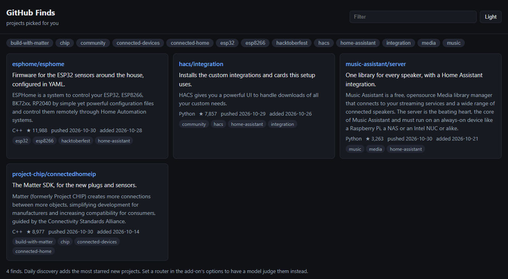

# GitHub Finds

A Home Assistant add-on that finds new GitHub projects for your setup once a day and shows them on one page in the sidebar: name, why it was picked, description, language, stars, last push and tags. With no options it adds the most starred new projects for a set of Home Assistant topics; point it at a local model (Ollama or any OpenAI-compatible server) and the model judges each project against your setup instead.

[](https://my.home-assistant.io/redirect/supervisor_add_addon_repository/?repository_url=https%3A%2F%2Fgithub.com%2Fheidrickla%2Fha-github-finds)

[](https://my.home-assistant.io/redirect/supervisor_addon/?addon=75df1782_github_finds&repository_url=https%3A%2F%2Fgithub.com%2Fheidrickla%2Fha-github-finds)

## Screenshots



Each card shows why the project was picked, its description, language, stars, last push and tags.

## Setup

1. Press the first button to add this repository, then the second to open the add-on.
2. Install and start it. Nothing needs to be typed.
3. Open Finds in the sidebar. The first search runs two minutes after the start.
4. Optional: set `router` to a local model's OpenAI-compatible URL to have it judge each project, and `interests` to describe your setup.

The page's footer and the add-on's log say what discovery does with the current options.

## Options

| Option | Default | Meaning |
|---|---|---|
| `discover` | `true` | Search GitHub once a day and add new projects. |
| `per_day` | `3` | The most projects one day adds, 1 to 10. |
| `topics` | `home-assistant`, `hacs`, `esphome`, `zigbee`, `matter`, `home-automation` | GitHub topics, one search each. |
| `router` | empty | Optional. An OpenAI-compatible base URL ending in `/v1`, such as `http://<host>:11434/v1` for Ollama. Empty picks the most starred. |
| `model` | empty | Optional. The model name; empty takes the first model the router lists. |
| `interests` | empty | Optional. A few sentences about your setup, for the model. Empty uses the topics. |

Discovery, the list file and the optional command-line tool are described in [DOCS.md](github_finds/DOCS.md).

## Development

| Path | What |
|---|---|
| `github_finds/` | The add-on: config, Dockerfile (builds the binary), AppArmor profile, docs. |
| `github_finds/finds/src/lib.rs` | The link model, the rules an entry must pass, and the server's routes. |
| `github_finds/finds/src/discover.rs` | Daily discovery: the search, candidate filter, the stars or model verdict, selection and merge. |
| `github_finds/finds/src/main.rs` | `serve` with the daily discovery thread; `discover` for one run now; `add`, `list`, `remove` over SSH. |
| `github_finds/finds/src/web/` | The page, embedded in the binary. |
| `tools/deploy.sh` | Copies the add-on to a host's `/local_apps` as a local add-on (`HA_SSH=user@host`). |

Gates, from `github_finds/finds`:

```
cargo fmt --check
cargo clippy --locked --all-targets -- -D warnings
cargo nextest run --locked
cargo deny check
```

CI runs these, frenck's app linter, yamllint, hadolint and an image build for amd64 and aarch64 that starts the image and waits for its health check.

## Licence

MIT. See `LICENSE`.
